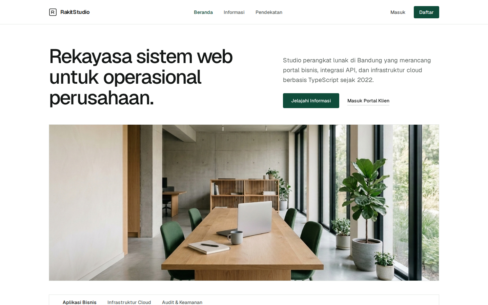
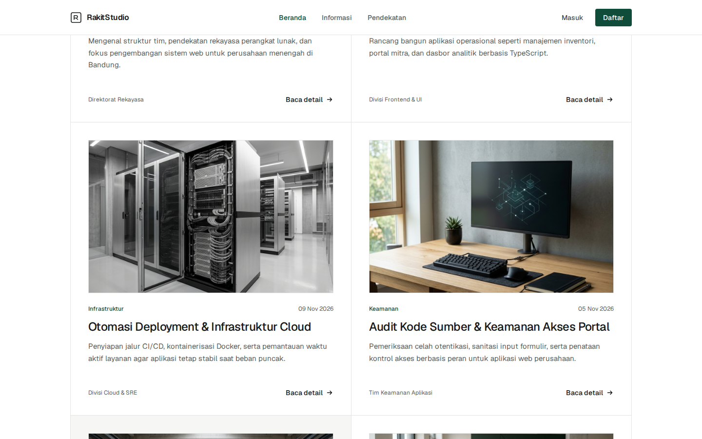
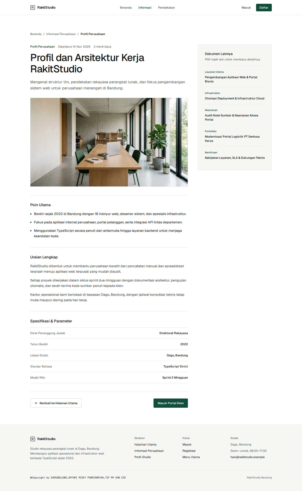
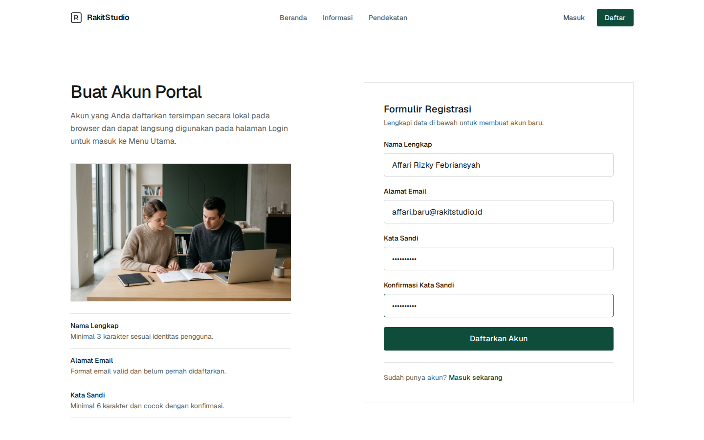
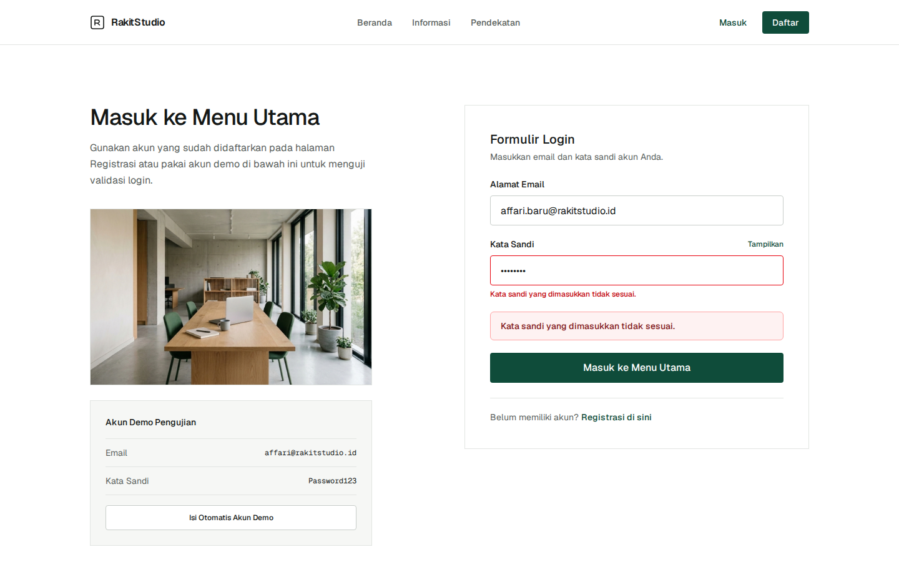
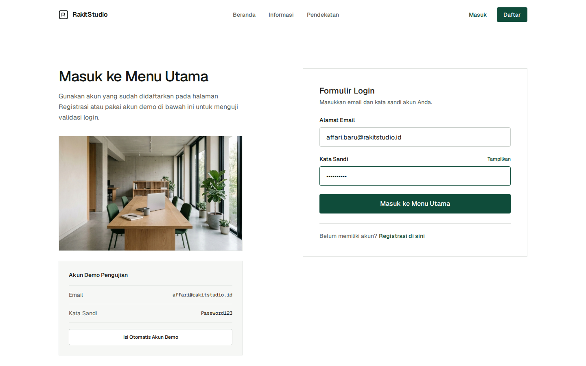
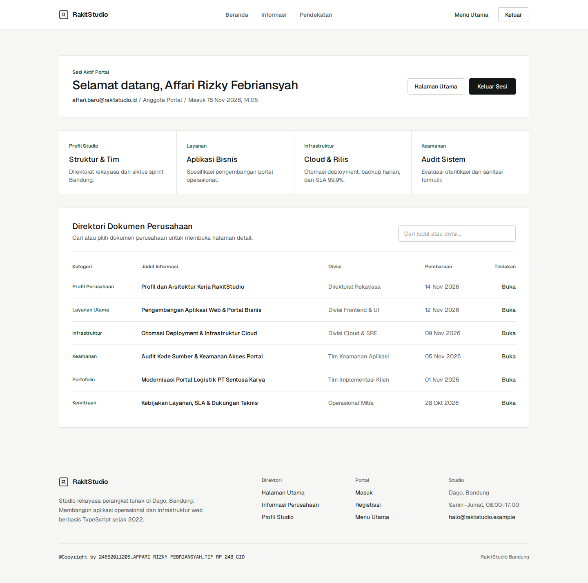
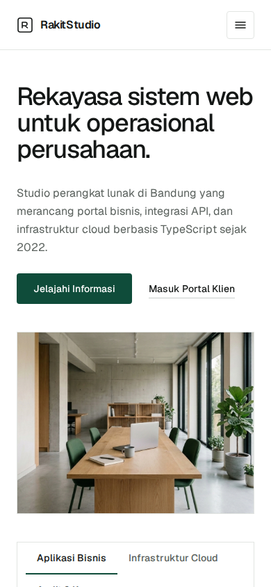

# RakitStudio — Portal Informasi Perusahaan & Sistem Akses (Project 1)

Website profil dan portal informasi perusahaan **RakitStudio** (Studio Rekayasa Web & Infrastruktur Cloud, Bandung) yang dibangun menggunakan **TypeScript**, **Vite**, dan **Tailwind CSS v4**.

## Identitas Mahasiswa

- **Nama:** Affari Rizky Febriansyah
- **NPM:** `24552011205`
- **Kelas:** `TIF RP 24B CID`

## Fitur Utama

1. **Halaman Utama (`index.html`)**
   - Hero editorial dengan panel spesifikasi interaktif (`Aplikasi Bisnis`, `Infrastruktur Cloud`, `Audit & Keamanan`).
   - Kumpulan informasi perusahaan (`INF-01` hingga `INF-06`) lengkap dengan filter kategori yang mengarah ke Halaman Detail Informasi.
   - Bagian pendekatan rekayasa dan footer konsisten.
2. **Halaman Detail Informasi (`detail.html`)**
   - Menampilkan uraian lengkap, poin utama, foto visual, dan tabel spesifikasi dari informasi yang dipilih di Halaman Utama (`detail.html?id=...`).
   - Menyediakan daftar dokumen perusahaan lainnya di sidebar serta penanganan halaman `404` apabila parameter `id` tidak valid.
3. **Halaman Login (`login.html`)**
   - Formulir login dengan fungsi validasi TypeScript menggunakan struktur percabangan `if / else if / else` (`validateLogin` pada `src/utils/auth.ts`).
   - Menampilkan pesan error spesifik per kolom saat input salah, serta langsung mengarahkan ke **Halaman Menu Utama (`menu.html`)** apabila kredensial sesuai.
   - Dilengkapi fitur tampilkan/sembunyikan kata sandi dan tombol isi cepat akun demo.
4. **Halaman Registrasi (`register.html`)**
   - Formulir pendaftaran akun baru dengan validasi nama, format email, panjang kata sandi, dan kecocokan konfirmasi kata sandi menggunakan struktur percabangan `if`.
   - Data akun tersimpan di `localStorage` browser dan langsung dapat digunakan untuk login.
5. **Halaman Menu Utama (`menu.html`)**
   - Dilindungi pemeriksaan sesi (`if (!session)` otomatis diarahkan ke `login.html`).
   - Menampilkan identitas pengguna yang sedang login, waktu masuk, pintasan modul perusahaan, pencarian dokumen secara langsung, dan tombol **Keluar Sesi**.
6. **Footer di Semua Halaman**
   - Seluruh halaman menampilkan footer konsisten dengan format:
     `@Copyright by 24552011205_AFFARI RIZKY FEBRIANSYAH_TIF RP 24B CID`

## Tech Stack

- **Bahasa:** TypeScript (`strict: true`)
- **CSS Framework:** Tailwind CSS v4 (`@tailwindcss/vite`)
- **Build Tool:** Vite (Multi-Page Application)
- **Browser Testing & Screenshot:** Playwright (`playwright` + Chromium)

## Struktur Proyek

```text
UTS_WEB1/
├── index.html              # Halaman Utama
├── detail.html             # Halaman Detail Informasi
├── login.html              # Halaman Login
├── register.html           # Halaman Registrasi
├── menu.html               # Halaman Menu Utama (setelah login)
├── public/images/          # Aset foto studio dan operasional
├── screenshots/            # Tangkapan layar seluruh fitur untuk dokumentasi
├── src/
│   ├── config/site.ts      # Konfigurasi identitas & format copyright
│   ├── data/companyInfo.ts # Data informasi perusahaan
│   ├── pages/              # Skrip TypeScript tiap halaman
│   ├── styles/main.css     # Konfigurasi Tailwind CSS & token desain
│   └── utils/              # Logika otentikasi (`if`) dan layout header/footer
├── tsconfig.json
└── vite.config.ts
```

## Cara Menjalankan di Lokal

```bash
npm install
npm run dev
```

Untuk memeriksa tipe TypeScript dan membangun versi produksi:

```bash
npm run build
```

## Akun Demo Pengujian Login

- **Email:** `affari@rakitstudio.id`
- **Kata Sandi:** `Password123`

*(Anda juga dapat membuat akun baru terlebih dahulu melalui halaman `register.html`.)*

---

## Screenshot Fitur Aplikasi

### 1. Halaman Utama — Hero & Panel Interaktif (`index.html`)


### 2. Halaman Utama — Kumpulan Informasi Perusahaan (`#informasi`)


### 3. Halaman Detail Informasi (`detail.html`)


### 4. Halaman Registrasi (`register.html`)


### 5. Halaman Login — Validasi Percabangan `if` Saat Input Salah (`login.html`)


### 6. Halaman Login — Siap Masuk (`login.html`)


### 7. Halaman Menu Utama Setelah Login Berhasil (`menu.html`)


### 8. Tampilan Responsif Seluler (`390x844`)

