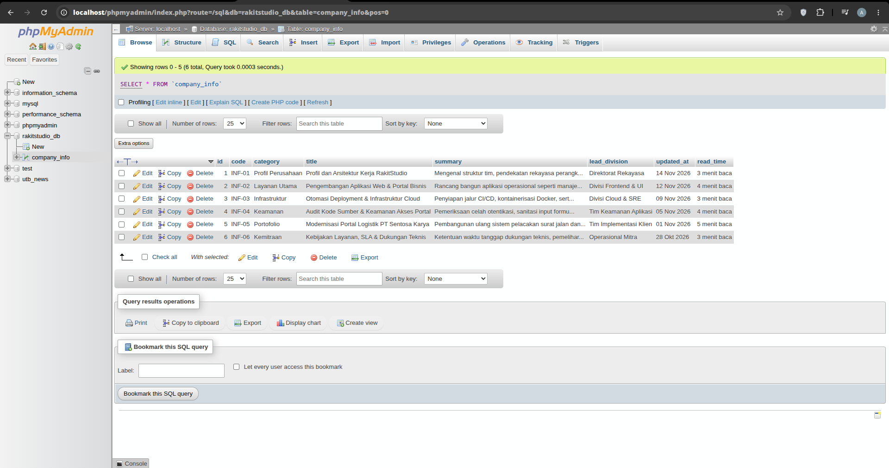
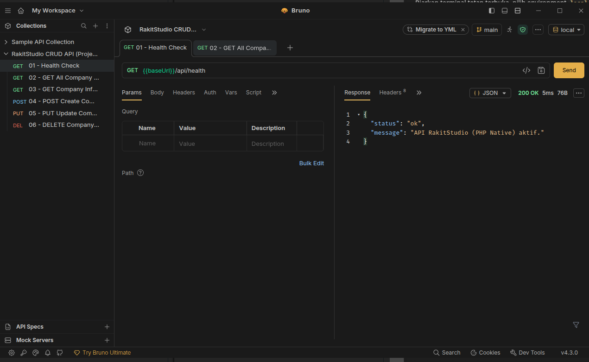
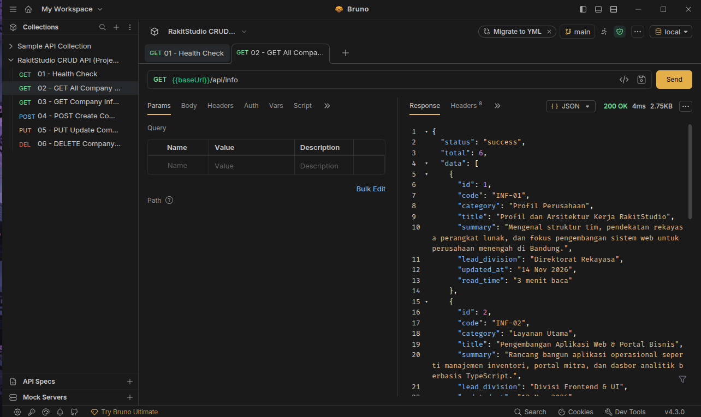
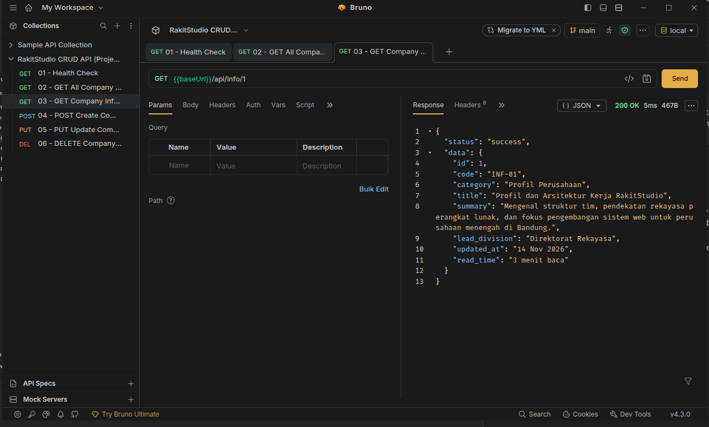
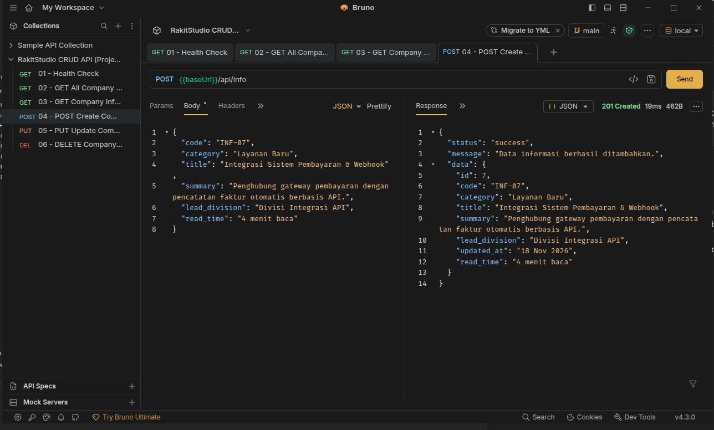
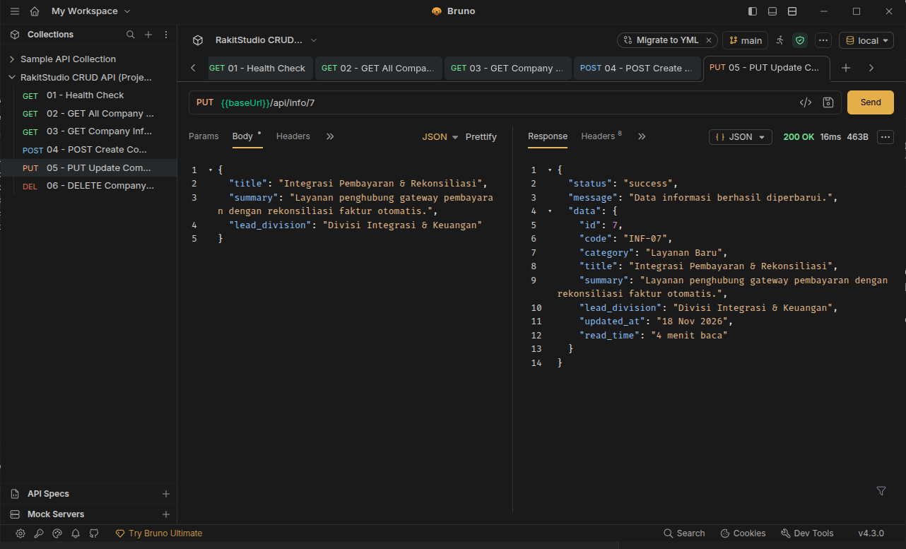
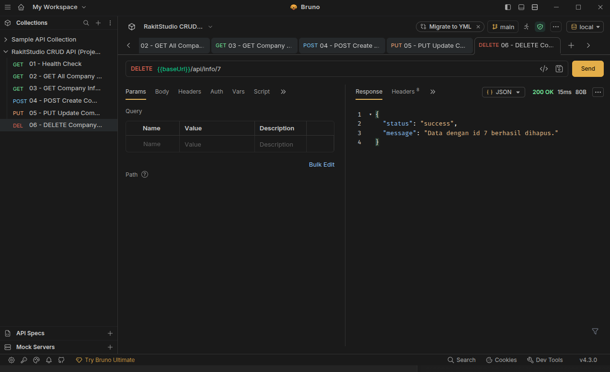

# Project 2 — CRUD API Informasi Perusahaan (PHP Native + phpMyAdmin)

REST CRUD API sederhana menggunakan **PHP Native** dan **MySQL / MariaDB (phpMyAdmin)** yang mengelola data informasi perusahaan **RakitStudio** sesuai data dummy pada Project 1.

## Identitas Mahasiswa

- **Nama:** Affari Rizky Febriansyah
- **NPM:** `24552011205`
- **Kelas:** `TIF RP 24B CID`

## Struktur Folder

```text
project-2/
├── index.php               # Router & handler CRUD API
├── .htaccess               # Rewrite URL untuk Apache (LAMPP/XAMPP)
├── database.sql            # Skema tabel `company_info` + 6 data awal
├── config/
│   └── database.php        # Koneksi PDO ke MySQL/MariaDB
├── bruno/                  # Koleksi request Bruno siap uji
└── screenshots/            # Hasil screenshot pengujian di Bruno / Postman
```

## Cara Menjalankan (LAMPP + phpMyAdmin)

1. Jalankan service **Apache** dan **MySQL** dari LAMPP:
   ```bash
   sudo /opt/lampp/lampp start
   ```
2. Buka **phpMyAdmin** di browser (`http://localhost/phpmyadmin`), klik tab **Import**, lalu pilih file `project-2/database.sql` (otomatis membuat database `rakitstudio_db`, tabel `company_info`, dan 6 data awal).
3. Sambungkan folder `project-2` ke `htdocs` LAMPP (atau jalankan PHP built-in server):
   - **Via LAMPP Apache (symlink):**
     ```bash
     sudo ln -s /home/leon/myshit/UTS_WEB1/project-2 /opt/lampp/htdocs/project-2
     ```
     Base URL: `http://localhost/project-2`
   - **Via PHP Built-in Server:**
     ```bash
     cd /home/leon/myshit/UTS_WEB1/project-2
     /opt/lampp/bin/php -S 127.0.0.1:8000 index.php
     ```
     Base URL: `http://127.0.0.1:8000`

## Daftar Endpoint CRUD

| Method | Endpoint | Keterangan |
| :--- | :--- | :--- |
| `GET` | `/api/health` | Cek status API |
| `GET` | `/api/info` | Ambil seluruh data informasi perusahaan (opsional `?category=...`) |
| `GET` | `/api/info/{id}` | Ambil 1 detail data berdasarkan `id` |
| `POST` | `/api/info` | Tambah data baru (body JSON) |
| `PUT` | `/api/info/{id}` | Ubah data berdasarkan `id` (body JSON) |
| `DELETE` | `/api/info/{id}` | Hapus data berdasarkan `id` |

### Contoh Request Body (`POST /api/info`)

```json
{
  "code": "INF-07",
  "category": "Layanan Baru",
  "title": "Integrasi Sistem Pembayaran & Webhook",
  "summary": "Penghubung gateway pembayaran dengan pencatatan faktur otomatis berbasis API.",
  "lead_division": "Divisi Integrasi API",
  "read_time": "4 menit baca"
}
```

---

## Hasil Pengujian API (Bruno & phpMyAdmin)

Pengujian dilakukan menggunakan koleksi [bruno/](bruno) pada environment `local` (`http://127.0.0.1:8000`) dengan database `rakitstudio_db` di phpMyAdmin:

### 1. Database `rakitstudio_db` di phpMyAdmin (`company_info`)


### 2. `GET /api/health` — Cek Status Server API (`200 OK`)


### 3. `GET /api/info` — Menampilkan Seluruh Data (`200 OK`)


### 4. `GET /api/info/1` — Menampilkan Detail Data (`200 OK`)


### 5. `POST /api/info` — Menambah Data Baru (`201 Created`)


### 6. `PUT /api/info/7` — Memperbarui Data (`200 OK`)


### 7. `DELETE /api/info/7` — Menghapus Data (`200 OK`)


